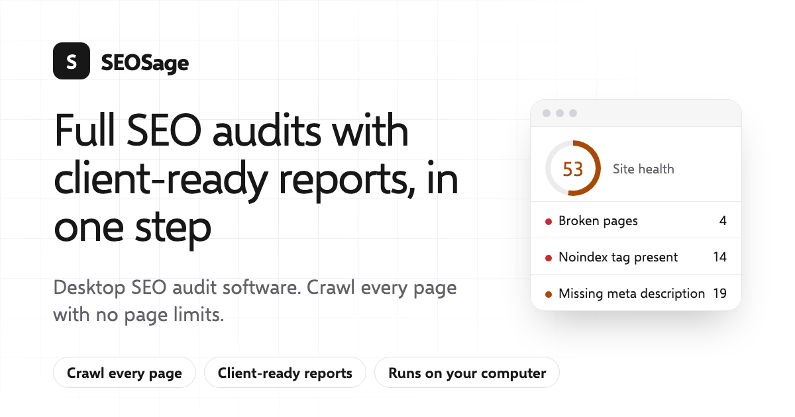
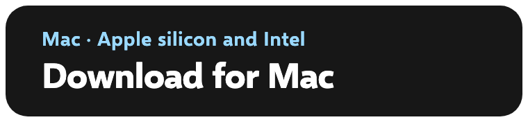
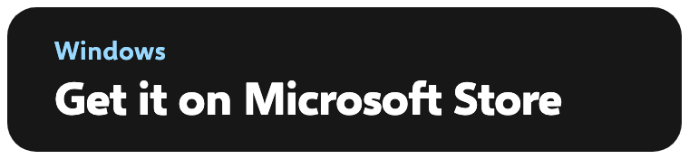
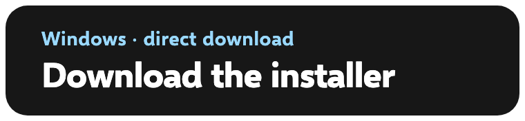
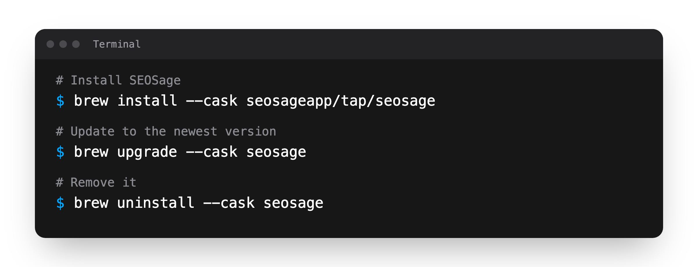
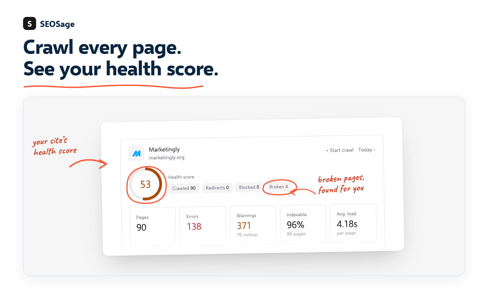
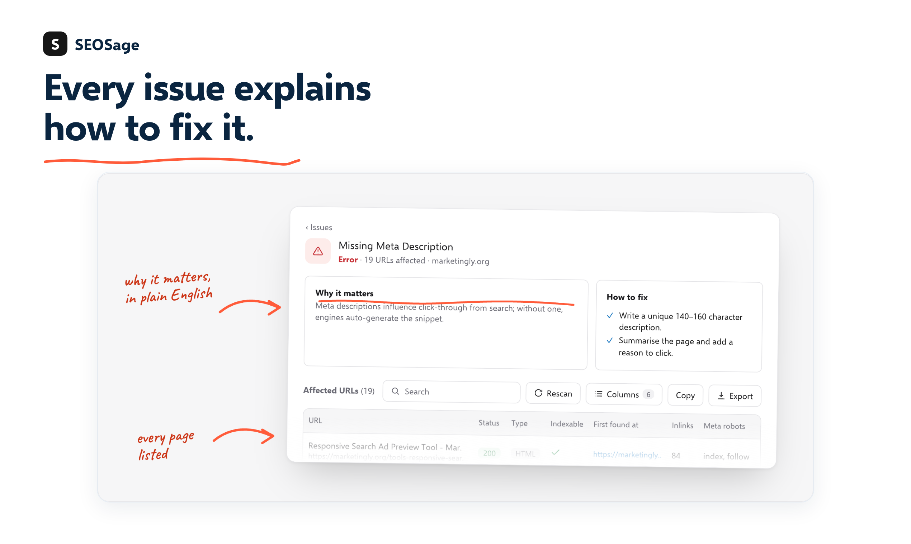
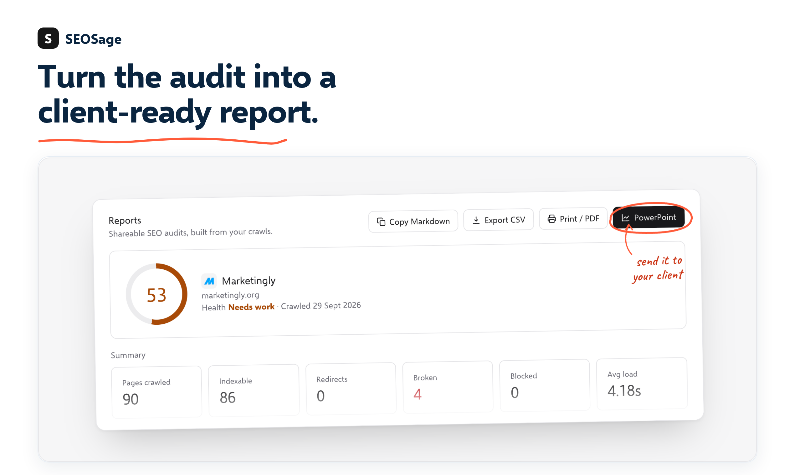

  

<h1 align="center">Download SEOSage</h1>

<b>Desktop SEO audit software for Mac and Windows.</b> Crawl every page of a website on your own computer, with no page limits, and turn the results into client-ready reports.

  
  &nbsp;
  
  &nbsp;
  

Every plan starts with a 14-day free trial (no card needed). Plans start at $9 a month.

---

## Install

| | How |
| --- | --- |
| **Mac** (Apple silicon and Intel) | [Download from seosage.co](https://seosage.co/download/), or use Homebrew below |
| **Windows** | [Microsoft Store](https://apps.microsoft.com/detail/9NTLPMTCZ6K2), or the [direct installer](https://seosage.co/download/) |
| **Homebrew** (Mac) | `brew install --cask seosageapp/tap/seosage` |

The Homebrew install file lives in [SEOSageApp/homebrew-tap](https://github.com/SEOSageApp/homebrew-tap).

## What you get

- **Every page, no limits:** crawl live sites, staging sites and password-protected sites
- **Fix and re-check:** confirm a fix worked without crawling the whole site again
- **White-label reports:** PowerPoint, PDF, Excel and CSV with your own logo
- **Your data stays local:** crawls run and stay on your computer
- **Works with Claude:** ask about your crawl in plain English, or build a report deck

## Links

[Website](https://seosage.co) · [Features](https://seosage.co/features/) · [Pricing](https://seosage.co/pricing/) · [Free SEO tools](https://seosage.co/tools/) · [Changelog](https://seosage.co/changelog/) · [Security](https://seosage.co/security/)

Questions or feedback: [Discussions](https://github.com/orgs/SEOSageApp/discussions) · [hello@seosage.co](mailto:hello@seosage.co) · [X](https://x.com/SEOsageapp) · [LinkedIn](https://www.linkedin.com/company/seosage/) · [YouTube](https://www.youtube.com/@SEOSageApp)

This repository only points to the SEOSage installers. The app's source code is not published here.
